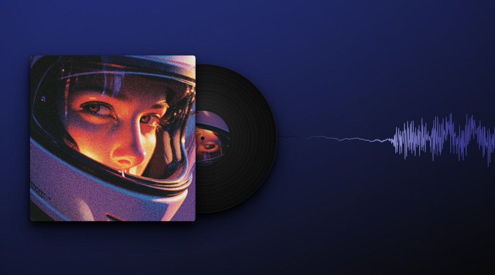
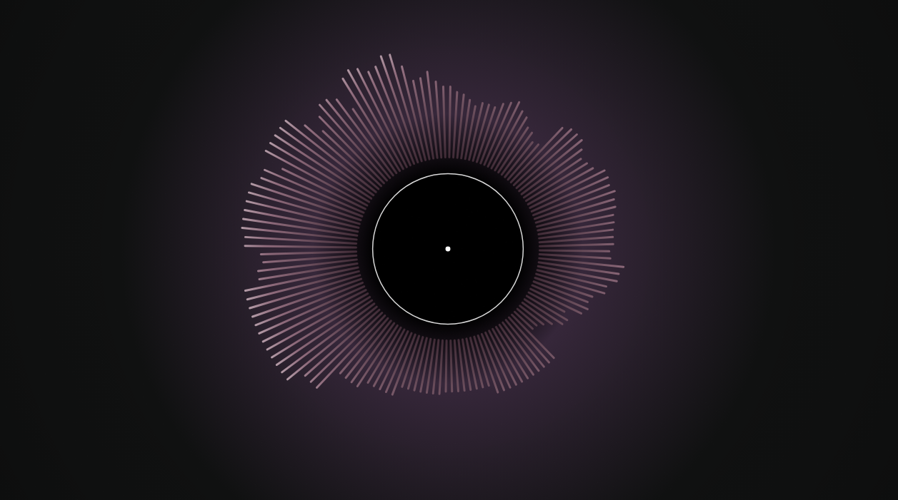
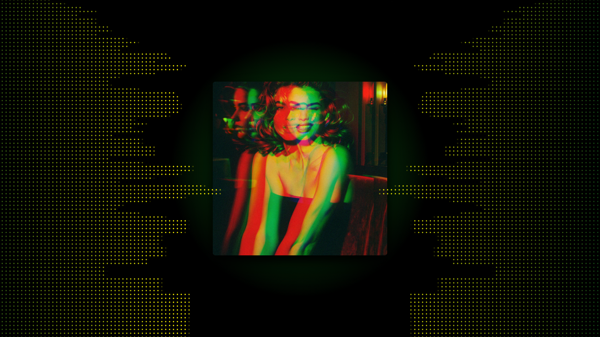
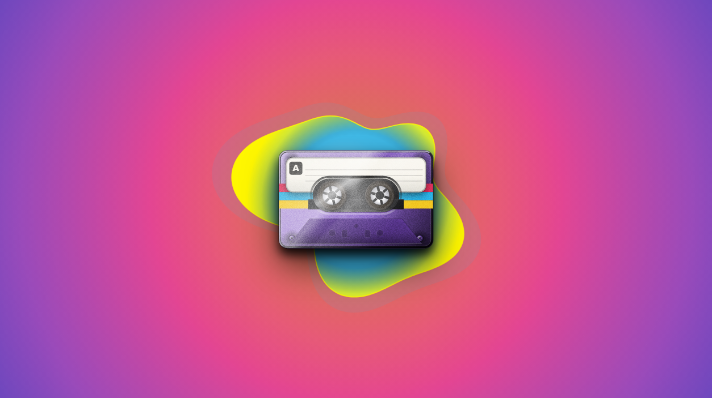
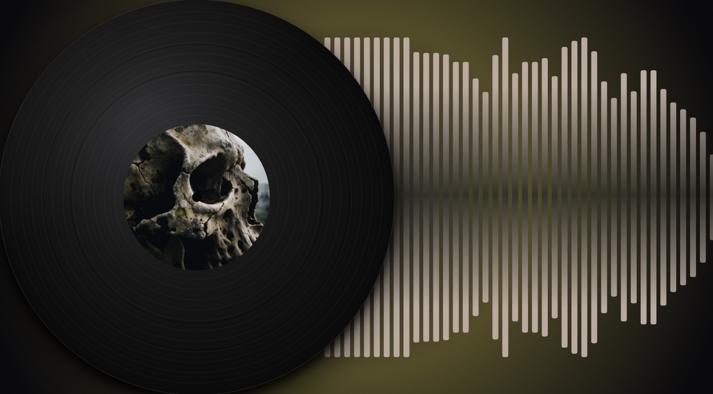
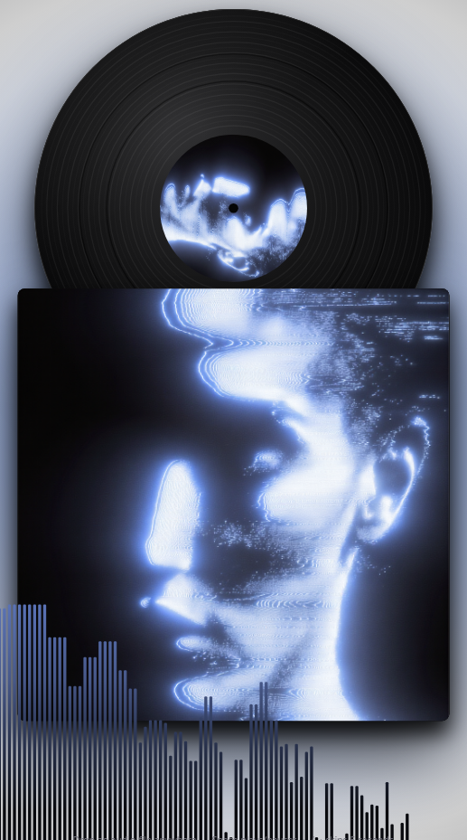
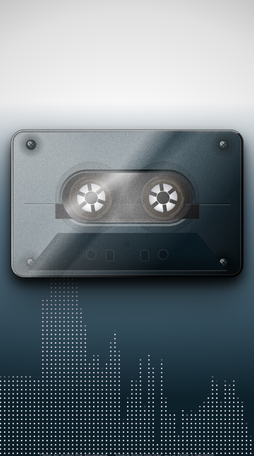

# Spectra — Audio Visualizer Editor

**▶ Try it live: <https://mpem1.github.io/spectra/>** — free, no account, nothing to install.

A browser-based music visualizer studio: load a track, design the look in real
time, and export frame-exact MP4 videos — fully offline, no server rendering.

Built with Next.js 16 (App Router) · TypeScript · Zustand · Canvas 2D ·
Tailwind CSS 4 · shadcn/ui · WebCodecs · IndexedDB (browser-local projects).

## Gallery — signature presets

The **Presets** tab ships with built-in **signature looks** — one click
applies a complete setup: visualizer, palette, background, spinning record
or cassette, everything. Here are some of them, wearing real album art:

<table>
  <tr>
    <td align="center"><br><b>Vinyl &amp; Cover</b><br><sub>Indigo dusk wave · big sleeve with the record sliding out</sub></td>
    <td align="center"><br><b>Radial Fade</b><br><sub>Plum-to-white sunburst over a violet bloom</sub></td>
    <td align="center"><br><b>Side EQ Cover</b><br><sub>Green grid EQ down the side · centered cover</sub></td>
  </tr>
  <tr>
    <td align="center"><br><b>Cassette Blob</b><br><sub>Sunset blob backdrop · realistic purple cassette</sub></td>
    <td align="center"><br><b>Large Vinyl</b><br><sub>Giant off-center vinyl over a red-gold bloom</sub></td>
    <td></td>
  </tr>
  <tr>
    <td align="center"><br><b>Record Phone</b><br><sub>Teal-to-white fade · record stacked above its sleeve</sub></td>
    <td align="center"><br><b>Cassette Phone</b><br><sub>Dark cassette over a lavender grid · white-to-teal fade</sub></td>
    <td></td>
  </tr>
</table>

## Features

- **Visualizer styles** — Bars, Wave, Radial, Particles, Blob, Grid; each with
  configurable bar count, smoothing, glow, and spacing.
- **Visualizer layout** — the whole visualizer is a movable, resizable layer
  (Position X/Y + Size), so it can shrink into a spectrum column beside the
  spinning disc, hug an edge, or fill the classic full-width layout (50 / 50 /
  100% = unchanged).
- **Vertical orientation** — Bars, Wave and Grid can flip from the classic
  left→right strip to a full-height top→bottom column (bass stays at the
  bottom; mirror modes, layer order, and every other slider keep working).
  A Side picker chooses which edge the column hangs from — left or right.
- **Beat motions** — the background can bounce (zoom), shake (jitter) and
  blur-pulse (smear on the kick) with the bass, each with its own strength.
- **Auto-palette** — one click next to the gradient header pulls the
  visualizer's colors straight from the uploaded album art (angle, shape and
  cycling settings are preserved; lyrics/titles following the visualizer
  palette match automatically).
- **Beat bounce** — image / video / GIF backgrounds gently zoom with the bass
  (up to +8% at full strength; 0 = exact no-op). The vinyl & cover has its own
  audio-reactive pulse, so the whole scene can breathe with the beat.
- **Pulse image** — a PNG/SVG logo or emblem that floats over (or behind) the
  scene and swells with the music like the blob/radial styles, with slow-spin
  and a glow tinted by the visualizer palette; front/back layering included.
- **Corner watermark** — a small logo or @handle pinned to any corner, drawn
  above lyrics/titles and baked into every MP4/PNG export.
- **Screen filter** — plays the whole picture on a virtual CRT: scanlines, an
  RGB phosphor mask, chromatic aberration and a soft glow drawn over
  everything (watermark included) and baked into every export. Lives in its
  own **Filters** tab, with sliders for mask size, scanline strength, mask
  strength, color split and glow.
  Skipped on transparent backgrounds so alpha recordings stay clean.
- **VHS tape filter** — worn-out tape look: wavy line wobble, a rolling
  tracking-noise band and white dropout specks over the whole picture, with
  sliders for wobble, tracking (band strength), tracking speed (how often
  the band rolls through — lower it and the tape behaves between passes,
  without weakening the band) and dust.
- **Film reel filter** — old school film: vertical emulsion scratches that
  wander, dust and hairs that pop, and a gentle exposure flicker, with
  sliders for scratches, dust, reel speed (how fast the artifacts churn —
  the amount dials never touch it) and flicker.
- **Halftone print filter** — newspaper dots on a 45° grid, applied only to
  the darker tones (the Shadow range slider decides how dark a color must be
  before it gets dotted) while lighter areas stay intact, with dot size,
  shadow range and ink strength sliders.
- **Glitch filter** — digital corruption bursts: chunky pixel blocks (some
  pixelated in place, some copied from the wrong spot, some tinted), picture
  slices shoved sideways and raw color bars stamped over the frame. Burst
  rate is its own dial — rare stutters at low settings, continuous
  corruption at 100% — while Blocks and Slices keep each burst just as
  strong.
- **3D glasses filter** — the old-school red/blue paper anaglyph look: the
  whole picture is re-projected twice, once through red and once through
  cyan, shifted apart so every edge wears classic 3D fringes. Depth sets the
  separation, Beat pop pushes the layers wider on the song's low end and Mix
  blends the look back toward the original picture.
- **React to beat (every filter)** — a beat-sync switch on every filter card,
  the filter twin of the background's beat bounce / shake / blur pulse: on
  beats the filter punches harder (CRT split widens + glow flares + the
  screen brightens, VHS wobble/tracking/dust kick with extra bands tearing
  loose, film artifacts darken with a warm lamp flare, halftone print
  saturates and the dots swell, glitch bursts fire on the kick, 3D fringes
  pop wider), and between beats the look rests exactly where the sliders set
  it. A Beat pop slider dials how hard each kick hits; exports bake the
  identical punches (the offline renderer reads the same deterministic bass
  envelope as the live preview).
- **Project files** — download the entire setup (every uploaded image
  included, no size cap) as a `.spectra` file and reopen it anywhere; share
  links still work for quick look-sharing without the media.
- **Gradient editor** — multi-stop gradients with per-stop opacity, linear or
  radial shape, angle control (0° = bottom→top, 90° = left→right, 180° =
  top→bottom), color cycling, named gradient presets (Sunset, Aurora, Ember,
  Neon, Mono) and user-saved gradients.
- **Mirror / Center modes** — with a movable offset axis (added in
  `00461d3`), so the reflection axis no longer has to be the canvas center.
- **Orientation-true preview** — the preview canvas takes the exact shape of
  the selected export resolution (landscape 16:9, square 1:1, portrait 9:16),
  and the Export tab shows a live outline of the frame format — what you
  compose is what renders.
- **Backgrounds** — solid, gradient, image (pan/zoom/blur), looping **video
  or animated GIF** (muted, cover-fit, frame-exact in exports — GIFs are
  decoded into deterministic frames), or transparent (alpha recording).
  Zoom an image or video out, or use a cut-out PNG: the area it doesn't
  cover gets a clean dark backdrop — no leftover trails from previous
  frames, in the preview and in every export.
- **Lyrics tab** — synced lyric lines rendered into the visualizer, plus a
  **title card**: a free-positioned intro title that fades in at a set time,
  holds for a set duration, and fades out — with glow, outline, and either
  the visualizer palette or its own custom gradient. The size can **pulse
  with the music** (text swells on loud hits) and the whole block can
  **swivel** around its center axis with adjustable swing and speed.
- **Vinyl & cover** — upload album art and get the classic record-player
  look: a square cover with a spinning vinyl sliding out from behind it
  (art on the center label, grooved black face, spindle hole), or the art
  across the full disc like a CD with a punched center hole. The cover and
  the disc share your art by default — or upload a **separate disc face
  image** so the record (vinyl label, CD face, or cassette label) carries
  its own picture while the sleeve keeps the original. Real-RPM spin
  (33⅓ / 45 presets) with direction toggle, audio-reactive size pulse,
  groove rings, and a light sheen — composes with every visualizer style.
  Both the cover and the disc move and resize freely — size up to **200%**
  of the frame and X / Y from -50 to 150, so both can match each other's
  scale and bleed past the visible edges — and the art inside each zooms
  (1–3×) and slides independently so you choose exactly which part of the
  artwork shows on the sleeve, label, or CD face. The **visualizer layer**
  can sit in front of the vinyl & cover (classic look) or tuck behind them
  so the record overlaps the bars.
  Or flip the face to a whole **cassette tape** with turning sprocket hubs:
  any shell color, and the label is bare plastic, your album art, or the
  built-in mixtape design (A badge, ruled lines, three custom stripe colors,
  and your own text written on the rules). The cassette comes in two styles —
  a clean **vector** illustration or a shaded **realistic** render lit like a
  photo: diagonal key light with a hotspot, beveled rims, contact shadows
  under the label and screws, see-through reel silhouettes on bare
  smoke-plastic shells, a glass window reflection with a hard specular
  streak, twin glossy streaks, a shadowed far corner and film grain. Every
  face also casts a **two-layer drop shadow** — a tight contact shadow plus
  a wide soft throw — whose depth (default 55), direction (angle) and
  **color** you control; on near-black backgrounds pick a lighter or
  colored shadow so it actually shows.
- **Projects** — save/load studio configurations, stored locally in the
  visitor's browser (IndexedDB) — no account, no server.
- **Legible controls** — the studio runs on a forced dark theme with
  high-contrast states everywhere: active tabs, mode chips and option cards
  are solid green with near-black text, every on/off switch is solid green
  (on) vs. visible gray (off) — never a faint tint — and the Export tab's
  Snapshot / PNG sequence buttons are dark chips with white text.
- **Shareable looks** — one click turns your whole setup into a link that
  anyone can open. See [Sharing a look](#sharing-a-look-one-click-link) below.

## Sharing a look (one-click link)

Any setup — visualizer style, colors, background, glow, lyrics styling — can
be turned into a plain web link that rebuilds it exactly, on any device:

1. Design your look in the studio.
2. Open the **Presets** tab and click the **link button** next to *Save* —
   the link is copied to your clipboard.
3. Paste it anywhere: chat, post, forum. Whoever opens it sees that exact
   look, loads their own audio, and hits play.

- The whole config is compressed into the URL itself (`?p=…`, gzip +
  base64url, ~600–700 chars) — no server, no account, no sign-up.
- Links are **snapshots**: changing your look later never changes links you
  already shared.
- Background **media pixels** (image / video / GIF, album art) are the one
  thing that can't fit in a URL — they fall back to a solid color on the
  receiving end (the app tells you in a toast). Everything else, including
  lyric styling, travels.

## Export pipeline (current state after session of 2026-10-26)

### Deterministic MP4 (WebCodecs, frame-exact)

Renders offline frame-by-frame (no rAF, deterministic smoothing state), encodes
H.264 + AAC and muxes to MP4 in-memory, then muxes the original decoded audio.
Export settings: format, frame rate (24/30/60), resolution (720p, 1080p,
1080×1080, 720×1280), length (full / 30s / 15s), and **quality tier**.

| Tier | Bits-per-pixel/frame | ~Bitrate @1080p30 | Clamp range |
|---|---|---|---|
| Standard | 0.10 | ~6.2 Mbps | 4–16 Mbps |
| High (default) | 0.20 | ~12.4 Mbps | 6–40 Mbps |
| Max | 0.35 | ~21.8 Mbps | 8–80 Mbps |

- Rate control: `bitrateMode: 'variable'` + `latencyMode: 'quality'`, chosen
  via `VideoEncoder.isConfigSupported()` with graceful fallbacks.
- H.264 High-profile **level is derived from resolution × fps** (4.0 / 4.2 /
  5.1) so files are always standards-legal (1080p60 → level 4.2, not 4.0).
- VBR undershoots the target on simple dark content by design; the tiers
  matter most for complex content (background images, particles, glow).
- **Audio: true stereo** straight from the decoded source buffer (no mono
  mixdown), **AAC-LC 256 kbps** (Opus 192 kbps fallback at 48 kHz), source
  sample rate preserved, and **truncated to the export length** so 15s/30s
  previews stay in sync.

### Live recording (MediaRecorder)

Real-time WebM capture of the preview canvas with an explicit
`videoBitsPerSecond` (0.2 bpp @30 fps, clamped 4–20 Mbps — Chrome's ~1 Mbps
default was the main quality killer). Alpha (VP9 + alpha) is used when the
background is transparent. Audio should come from the deterministic export for
perfect sync.

### Other capture

- **PNG snapshot** — current preview frame, lossless PNG.
- **PNG sequence** — offline frame-by-frame ZIP (capped frame count).
- **Convert dialog** — re-encodes a WebM recording (or any video) to MP4 in
  real time with its audio track.

## Deploying (GitHub Pages)

The app is **100% client-side** — the visualizer, the export pipeline, and
project storage all run in the browser — so it ships as a static site and
GitHub itself hosts it:

- `.github/workflows/deploy-pages.yml` runs on every push to `main`: installs
  deps with Bun, runs `STATIC_EXPORT=1 bun run build` (→ `output: 'export'`,
  `basePath: '/spectra'`, `trailingSlash: true` in `next.config.ts`), and
  publishes the `out/` folder to GitHub Pages. The first run also **enables
  Pages automatically** (`configure-pages` with `enablement: true`).
- Live URL once the workflow is green:
  **https://mpem1.github.io/spectra/**
- GitHub builds this in CI — never build locally in the dev sandbox.
- ⚠️ Pages for a **private** repo requires GitHub Pro. If the workflow fails
  at *Configure Pages* or the site 404s, make the repo public
  (Settings → General → Danger Zone → Change visibility) and re-run the
  workflow (Actions → Deploy to GitHub Pages → Run workflow).
- Future option for cross-device "cloud" projects: deploy the same repo to
  Vercel and add a hosted DB — the UI would only need its storage layer
  swapped (`src/lib/project-store.ts` is the single seam).

## Development

```bash
bun install
bun run dev        # dev server on :3000 (logs in dev.log)
bun run lint       # eslint
```

- Dev server must run on port 3000; never run `bun run build` in this
  sandbox — CI builds the static site.
- `bun run build` is mode-aware: `STATIC_EXPORT=1` → static export (used by
  CI); `bun run build:standalone` → the old self-hosted standalone build.
- `worklog.md` at the repo root is the detailed per-task engineering log.

## Session notes / picking this up next time

**Verified working (browser E2E):** export config actually reaches the
encoder (12.44 Mbps target, VBR, `avc1.640028` at 1080p30); exported MP4
decodes clean at 1:1 (no banding/blocking); audio track verified via
in-page `decodeAudioData` — 2 channels, L/R correlation ≈ 0.25 (true
stereo), 15.01 s audio from a 20 s source (truncation correct), 44.1 kHz
preserved. Mobile layout of the Export tab checked at 390 px.

**Known minor issues:**

- Radix slider thumbs across the studio have no accessible name
  (`aria-label` needs to be added per-thumb) — noted in worklog Task 10.
- Export toast auto-dismisses fast; if you miss it, the size is shown only
  there (could persist last-export info in the Export tab).

**Ideas worth considering next:**

- Optional "lossless audio" toggle (PCM in MP4 is poorly supported; more
  realistic: expose a WAV download of the mixdown alongside the MP4).
- Alpha-channel MP4/WebM export path for transparent backgrounds in the
  deterministic pipeline (currently only live recording supports alpha).
- Bitrate readback: show actual encoded bitrate/size estimate before export.
- Presets that bundle gradient + style + background + export settings.
